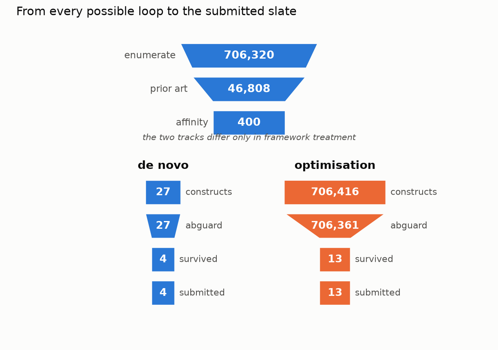

<p align="center">
  
</p>

<h1 align="center">cdr3po · the HER2 stopping rule</h1>

<p align="center">
  <b>A calibrated funnel for antibody design.</b><br>
  Trastuzumab → 823,080 candidates → <b>17 designs we can defend</b>, one rejection reason at a time.
</p>

<p align="center">
  AI × Antibodies Hackathon, Oslo, 14 November 2026
</p>

---

## What this is

The challenge was to improve **trastuzumab**, a clinical antibody against HER2, on three
axes at once — binding affinity, epitope preservation and thermostability — and submit a
ranked list of designs for wet-lab testing.

Generating candidates is easy. **Deciding which ones to believe is the hard part**, and that
is what this repo is: a 14-step pipeline where every threshold is derived from a measurement
rather than chosen, and every rejected design can be traced to the step that rejected it.

> **The headline:** of 823,080 possible CDR3 variants, **17** survive. For each of the other
> 823,063 we can name the gate that killed it and the measurement that set that gate.

| | |
| --- | --- |
| **Deliverable** | [`results2/cdr3po.csv`](results2/cdr3po.csv) — 17 designs, 13 optimisation + 4 de novo |
| **Compliance** | 17 / 17 pass the organisers' `abguard team-validate`, first pass |
| **Tiering** | 3 designs clear all three axes; 14 clear two |
| **Full audit trail** | [`results2/funnel.json`](results2/funnel.json) — every count beside the threshold that produced it |

---

## Quickstart

```bash
git clone git@github.com:NOI-IoannisVardaxis/cdr3po-hackathon.git
cd cdr3po-hackathon

make dev                                   # virtualenv + dependencies, via uv
uv run her2 steps                          # list the 14 steps
uv run her2 config                         # print every threshold currently in force

uv run her2 run --path optimisation        # the CPU path, end to end — no GPU, no network
```

Want to see it work in under a minute?

```bash
uv run her2 run --path optimisation --edit-distances 3 --shortlist-n 40
```

Every run is **deterministic** under `--seed` (default `1`). Same config, same designs. If it
differs, that is a bug, not noise.

Two things the pipeline needs that are **not** in this public repo — the organisers' data
tables and the `abguard` wheel. [PIPELINE.md](PIPELINE.md) has the setup, the full step table,
and what each threshold means.

---

## The funnel

<p align="center">
  
</p>

| Stage | In | Out | What happened |
| --- | ---: | ---: | --- |
| `03a_enumerate` | — | **706,320** | All 823,080 CDR3s at distance 3 across IMGT 3–12; 116,760 dropped for an unpaired cysteine |
| `04a_novelty` | 706,320 | **46,808** | **Prior art removes 93%.** 4.0 B pairs compared; a pigeonhole bound skipped 366.8 B as provably distant |
| `05a_affinity` | 46,808 | **400** | FACS surrogate ranking cut (ROC-AUC 0.922 on a held-out stratum) |
| `06a_optimisation` | 400 | **96** | Loops become full paired constructs, ≤ 250 aa |
| `06b_denovo` | 96 | **123** | ProteinMPNN framework redesign adds 27 de novo candidates |
| `07_fold` → `08_calibrate` | 68 | **68** | Co-folded with Boltz-2 and OpenFold3. **ipTM computed but deliberately not used as a filter** — see finding 2 |
| `09_epitope` | 68 | **17** | **The second big cut.** Contact recovery ≥ 0.900, where 0.900 is 90% of what the same model recovers on trastuzumab itself |
| `10b_stability` | 17 | 17 | ESM-IF1 log-likelihood vs the baseline's −1.0571; 3 designs beat it |
| `12_stop` | 17 | 17 | The stopping rule **declined to fire** — see finding 3 |
| `13_submit` | 17 | **17** | `abguard`: compliant |

**Two gates do essentially all the work:** prior art (93%) and the epitope check (75% of what
was left). Everything else is ranking.

---

## Four findings

These are the reason the funnel looks the way it does. Each one overturned the obvious move.

### 1 · A surrogate score of 0.5 is not "better than trastuzumab"

We never predict K<sub>D</sub>. The FACS surrogate answers *"is this a high binder"*, where
"high" is defined against the **variant population** — not against the parent antibody. Treating
`p_high > 0.5` as "improves on trastuzumab" is simply the wrong question.

So we calibrated it against the 187 SPR rows that have both a measured K<sub>D</sub> and a
comparable CDR3:

| Cutoff | Designs kept | Beat the 0.152 nM baseline | Precision |
| --- | ---: | ---: | ---: |
| 0.50 | 164 | 12 | **7.3%** |
| 0.90 | 110 | 12 | 10.9% |
| **0.99** | **30** | **12** | **40.0%** |

Base rate is **6.4%**. The obvious threshold is the base rate with extra steps; the strict one
is a **six-fold enrichment**. The surrogate's AUC *for the actually-judged question* is 0.857 —
the signal was there all along, and the round number was throwing it away.

### 2 · ipTM cannot separate binders from non-binders here

Everyone filters on ipTM. We calibrated it against 8,190 pairs that were **measured** not to bind.

- **AUC 0.645** — barely above chance.
- **94.3%** of measured non-binders score above 0.70.
- **81.7%** score above 0.80, the round number most pipelines use.
- Holding a 5% false-positive rate needs a cutoff of **0.9514**, which discards 82% of true binders.

So `08_calibrate` computes the cutoff and then **refuses to filter on it**. Dropping designs on a
metric this weak is noise dressed up as rigour. ipTM survives as a weak tie-break; the FACS
surrogate does the real work.

### 3 · The stopping rule declined to fire, and that is the finding

The rule needs a noise floor, which means two independent folding models that agree about reality.
On the trastuzumab baseline — **a solved crystal structure** — we measured:

| Model | Baseline ipTM |
| --- | ---: |
| Boltz-2 | **0.952** |
| Protenix v2 | 0.439 |
| OpenFold3 | 0.152 *(0.315 with a 7,875-sequence MSA)* |

Disagreement with a model that cannot reproduce a known answer measures **that model's failure**,
not our uncertainty. The rule therefore reports that it has nothing to measure rather than
inventing a threshold, and kept 17 of 17.

### 4 · The best designs are the most likely to be patented

Every rejection at the final gate was a **USPTO patent** hit — roughly half our top designs.
That is structural, not bad luck: the best loops sit nearest trastuzumab, which is the most
patent-encumbered region of the space. **The better a design scores, the likelier it is already
claimed.**

A team filtering only against the two provided data tables submits patent-colliding designs and
never finds out. `abguard` screens prior art we do not hold, which is why it runs on real
constructs throughout the pipeline, not just at the end.

### Bonus · Mutate the HER2 contacts, do not freeze them

The intuitive move is to protect the CDRH3 residues that touch HER2 and spend the mutation budget
elsewhere. **The data says the opposite:** contact-intact designs are **67.5%** high binders,
designs that mutate a contact are **81.9%**.

The reading: the novelty rule *forces* a mutation budget to be spent somewhere, and spending it on
contacts protects the functionally sensitive positions — which turn out not to be the ones touching
the antigen. Contacts sit at IMGT 3, 7, 8, 9 at a 5.0 Å cutoff.

---

## The designs

Top three, all of which clear all three axes:

| Rank | IMGT CDRH3 | Mutations | P(high) |
| ---: | --- | --- | ---: |
| 1 | `SREGGDGMWAMDY` | W3E, F8M, Y9W | 0.995 |
| 2 | `SRNGGDGWPAMDY` | W3N, F8W, Y9P | 0.995 |
| 3 | `SRWGGDGMWMMDY` | F8M, Y9W, A10M | 0.994 |

Trastuzumab is `SRWGGDGFYAMDY`. Note that positions 8 and 9 are HER2 contacts — deliberately so.

| File | Contents |
| --- | --- |
| [`results2/cdr3po.csv`](results2/cdr3po.csv) | The deliverable: the six columns `abguard` accepts |
| [`results2/submission_annotated.csv`](results2/submission_annotated.csv) | The same designs with track, mutations and the reason each was ranked where it was |
| [`results2/shortlist.csv`](results2/shortlist.csv) | Every scored design, with `dropped_by` naming its rejecting step |
| [`results2/funnel.json`](results2/funnel.json) | Counts, thresholds and timings per step |
| [`results2/report.html`](results2/report.html) | Figures, generated by `14_report` |

---

## How it works

Fourteen steps, each a pure function over `results/designs.parquet`: read the table, add the
columns you own, write it back.

**Steps never delete rows.** A design that fails a filter gets `dropped_by` set to the step that
rejected it, and stays. Three things follow:

1. The funnel counts are a **query**, not a reconstruction.
2. Any step **re-runs** without breaking the ones after it.
3. **Every rejection is answerable** — which is the whole point.

The two tracks differ only in mutation scope. Confine changes to CDR3 and Fv identity stays near
98%, so `abguard` classifies the design as *optimisation*; redesign the framework and identity falls
below 0.70, where it classifies as *de novo*. We measured the boundary: **60 framework mutations
gives 0.740 identity and stays optimisation, 80 gives 0.648 and flips.**

The de novo branch is not a binder from scratch. ProteinMPNN inverse-folds the trastuzumab backbone
keeping all six CDRs, so the paratope geometry survives and the loop is already ranked against
524,346 measured variants.

**→ [PIPELINE.md](PIPELINE.md)** for the step-by-step table, the configuration reference and the
setup the pipeline needs. **→ [GLOSSARY.md](GLOSSARY.md)** for the terminology.

---

## What we do not claim

Stated plainly, because a judge who finds these first scores them far worse.

- **Thermostability is a rank, not a T<sub>m</sub>.** ESM-IF1 log-likelihood against the baseline.
  The organisers' own guide rates computational substitutes for melting temperature as *"Moderate"*
  reliability. We do not claim better.
- **14 of 17 designs are tier 2 of 3.** Three clear all three axes. We report the tier each design
  earned, not the one we hoped for.
- **The stopping rule never fired.** It kept 17 of 17, because no second model could define the
  noise floor. That is finding 3, not an omission.
- **Only 4 loop families are represented.** Hierarchical clustering takes the best per cluster, but
  the space surviving both gates is genuinely narrow.
- **The designed disulfide was unsubmittable.** Geometry was sound at 4.11 Å (ALA106-H / ALA34-L),
  but `abguard` reads an inter-chain pair as two unpaired cysteines. 48 of 48 rejected.
- **The affinity surrogate is validated at distance 4 but applied at distance 3.** The production
  model does train on distance-3 data, so this is a conservative estimate rather than a leak.

---

## The rules, as the code actually implements them

The task PDF and the participant playbook state the novelty rule inconsistently and **both are
misleading.** These values are read from `abguard`'s source and confirmed by probing the installed
build.

| | |
| --- | --- |
| What is compared | the **IMGT CDRH3**, by Levenshtein distance |
| Trastuzumab's IMGT CDRH3 | **`SRWGGDGFYAMDY`** (13-mer) |
| `novel` (optimisation) needs | **≥ 3** mutations |
| `de_novo` needs | **≥ 2** mutations |
| Measured against | trastuzumab **and every CDRH3 in the reference** — 610,109 loops |
| Track assignment | whole-Fv identity ≥ 70% → `novel`, < 70% → `de_novo` |

Three traps worth stating plainly:

- **The 70% identity only picks the track.** It is not a pass/fail, and it is not CDRH3 identity,
  whatever the PDF says. You do not choose your track, and a design is never reclassified.
- **Use the IMGT 13-mer, never the 10-mer core** `WGGDGFYAMD` that the assay tables use. `abguard`
  re-derives every reference loop to IMGT precisely because comparing against the cores would hand
  every design three free mutations from the flanks alone.
- **The binding constraint is prior art, not trastuzumab.** A loop can sit 3 mutations from
  trastuzumab and still be rejected for landing 2 from something in the FACS screen — which is
  exactly what happened to one of our first two designs.

Two numbers that look contradictory and are not: **610,109** is `abguard`'s bundled reference index;
**525,042** is the blacklist our local pre-filter builds from the two provided tables plus
trastuzumab. The local filter is a cheap superset check that keeps the 900-second CLI off the hot
path — `abguard` still has the last word at step 13.

> ⚠️ **`novelty-report` does not check prior art.** It compares against trastuzumab alone and leaves
> `is_novel_enough` null, in a warning that is easy to miss. Only **`team-validate`** runs the full
> gate. Do not use the report as a pre-filter and assume the designs are submittable.

---

## Development

```bash
make dev      # virtualenv & dependencies
make test     # pytest, including doctests
make lint     # mypy, ruff, black, isort
make wheel    # check the wheel packages
```

Doctests live on the pure functions in `sequences.py`, `novelty.py` and `table.py` — the places
where an off-by-one silently changes which designs are legal. Four regression tests encode failures
we actually hit:

- trastuzumab itself must **fail** novelty,
- a 3-mutation design must clear the mutation floor,
- a paired construct must come out at 227 aa,
- the pruned prior-art scan must agree with unpruned brute force.

**Dependencies** are managed by [uv]: `uv add <package>`, or `uv add --dev <package>`. The change
lands in `pyproject.toml` and is locked in `uv.lock` — commit both.

### Outputs and what is tracked

`results/` holds outputs and run ids, never keys. The **text** files are committed —
`funnel.json`, `baseline.json`, `shortlist.csv`, `submission*.csv` — because showing where each
score came from is part of the work.

**`results/designs.parquet` is git-ignored.** It is a derived artefact: deterministic under
`--seed` and rebuilt by `03a_enumerate` in seconds. Tracking it would cost us a binary file that
**conflicts on every concurrent pull** when two people run steps, plus a history that grows by the
full table each time it is scored. Copy it with `scp` if it is ever genuinely needed.

### Credentials

**This repo is public.** Credentials stay outside it — `*.private.json` and `data/raw/` are
git-ignored. Point tools at the credentials file with an environment variable; never paste a key
into a prompt.

---

## Also in this repo

| | |
| --- | --- |
| [PIPELINE.md](PIPELINE.md) | Install, run, configure; the step table and threshold reference |
| [GLOSSARY.md](GLOSSARY.md) | Terminology |
| [docs/TOOLING.md](docs/TOOLING.md) | The external tools — `abguard`, Nebius, JapanFold, the folding models — and the traps we hit using each one |

[uv]: https://github.com/astral-sh/uv
